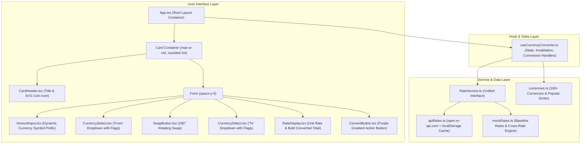
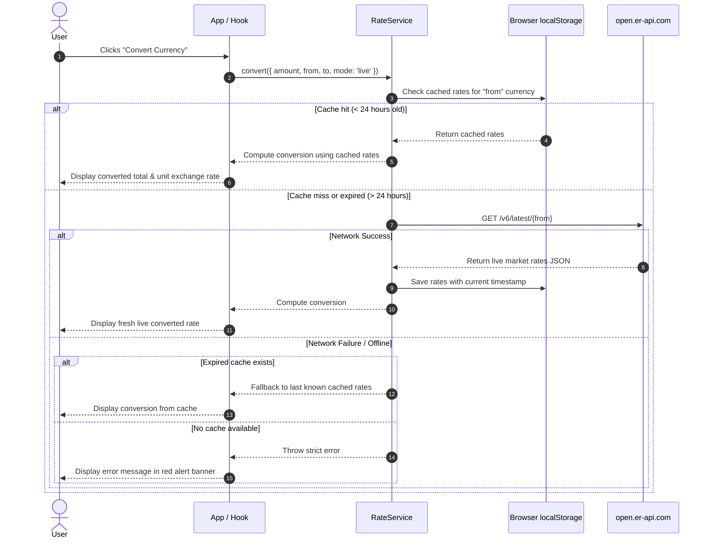

# 💱 Currency Converter

A modern, fast, and accessible Currency Converter web application built with **React 19**, **TypeScript**, **Vite**, and **Tailwind CSS**.

Features a clean centered card layout with a deep purple gradient aesthetic, on-demand conversion calculations, support for 160+ world currencies with national flags, bidirectional currency swapping, and a hybrid real-time API architecture powered by **ExchangeRate-API** with 24-hour `localStorage` caching and strict error fallback.

---

## 📑 Table of Contents

- [Features](#-features)
- [Tech Stack](#-tech-stack)
- [Architecture & Data Flow](#-architecture--data-flow)
  - [Component Hierarchy](#component-hierarchy)
  - [Rate Engine & Caching Flow](#rate-engine--caching-flow)
- [Project Structure](#-project-structure)
- [Getting Started](#-getting-started)
  - [Prerequisites](#prerequisites)
  - [Installation & Local Setup](#installation--local-setup)
- [Available Scripts](#-available-scripts)
- [Testing & Quality Assurance](#-testing--quality-assurance)
  - [Running Tests](#running-tests)
  - [Test Suite Breakdown](#test-suite-breakdown)
- [API Integration & Caching Details](#-api-integration--caching-details)
- [Contributing](#-contributing)
- [Attribution & License](#-attribution--license)

---

## ✨ Features

- 💜 **Clean Centered Card Layout**: Glassmorphic card design (`bg-white/95 backdrop-blur-md rounded-3xl shadow-2xl`) centered over a rich purple and indigo gradient backdrop.
- 🎯 **On-Demand Conversion**: Converted rates remain hidden on initial load and automatically clear whenever inputs change (typing an amount, changing dropdowns, or clicking swap). Results display **only** when the user clicks **"Convert Currency"**.
- 🌍 **160+ Global Currencies**: Comprehensive currency dictionary mapped to ISO 4217 codes, national flag emojis, full names, and currency symbols.
- ⭐ **Popular Currencies First**: The top 10 most traded global currencies (`USD`, `EUR`, `GBP`, `INR`, `JPY`, `CAD`, `AUD`, `CHF`, `CNY`, `SGD`) are pinned at the top for instant access, followed by the complete alphabetical list.
- 🔄 **Bidirectional Currency Swap**: One-click swap button with smooth animated rotation that swaps "From" and "To" currencies and clears the old conversion state.
- ⚡ **24-Hour Smart Caching**: Automatically saves fetched rates to the browser's `localStorage` to avoid redundant network calls and enable offline conversions.
- 🛡️ **Strict Error Fallback**: If offline or if the API is unreachable, the app leverages cached data if available; otherwise, it presents a clear, user-friendly error message.
- ♿ **Accessible**: Full ARIA labels, semantic HTML forms, focus-visible outlines, and dynamic currency symbols.

---

## 🛠 Tech Stack

| Technology | Version | Purpose |
| :--- | :--- | :--- |
| **[React](https://react.dev/)** | `^19.0.0` | Declarative UI component library |
| **[TypeScript](https://www.typescriptlang.org/)** | `~5.7.2` | Type safety, interfaces, and compile-time verification |
| **[Vite](https://vitejs.dev/)** | `^6.1.0` | Ultra-fast build tool and development server with instant HMR |
| **[Tailwind CSS](https://tailwindcss.com/)** | `^3.4.17` | Utility-first CSS styling and responsive layout |
| **[Vitest](https://vitest.dev/)** | `^3.0.5` | Fast unit test runner powered by Vite |
| **[Lucide Icons](https://lucide.dev/)** | `^1.16.0` | Clean, accessible SVG iconography |
| **[ExchangeRate-API](https://open.er-api.com/)** | Free v6 Open Tier | Real-time foreign exchange market rates provider |

---

## 🏛 Architecture & Data Flow

### Component Hierarchy



### Rate Engine & Caching Flow



---

## 📁 Project Structure

```
currency-converter/
├── index.html                      # HTML5 entry template
├── package.json                    # Project metadata, dependencies, and scripts
├── tsconfig.json                   # TypeScript compiler configuration
├── vite.config.ts                  # Vite bundler configuration
├── tailwind.config.js              # Tailwind CSS theme & animation configuration
├── postcss.config.js               # PostCSS plugins configuration
├── CONTRIBUTING.md                 # Contribution guidelines and workflow
├── README.md                       # Project documentation
└── src/
    ├── main.tsx                    # React application mount
    ├── index.css                   # Global styles & Tailwind directives
    ├── App.tsx                     # Main page container & form wiring
    ├── types/
    │   └── currency.ts             # TypeScript interfaces (Currency, ConversionResult, etc.)
    ├── data/
    │   └── currencies.ts           # 160+ currency metadata, popular codes, and sorting helpers
    ├── services/
    │   ├── apiRates.ts             # open.er-api.com client with 24h localStorage cache
    │   ├── mockRates.ts            # Baseline mock rates & cross-rate math engine
    │   ├── rateService.ts          # Unified service connecting UI with rate providers
    │   └── __tests__/
    │       └── rateService.test.ts # 14 Vitest automated unit tests
    ├── hooks/
    │   └── useCurrencyConverter.ts # Core hook managing inputs, invalidation, and conversion
    └── components/
        ├── AmountInput.tsx         # Controlled numeric input with dynamic symbol
        ├── CardHeader.tsx          # Card header with coin icon and title
        ├── ConvertButton.tsx       # Gradient action button with loading spinner
        ├── CurrencySelect.tsx      # Accessible dropdown with national flags and ISO codes
        ├── RateDisplay.tsx         # Clean conversion result card (hidden until convert)
        └── SwapButton.tsx          # Bidirectional swap button with 180° rotation
```

---

## 🚀 Getting Started

### Prerequisites

Ensure you have the following installed on your machine:
- **Node.js**: `v18.0.0` or higher (tested on Node v20/v22)
- **npm**: `v9.0.0` or higher

Check your installed versions:
```bash
node -v
npm -v
```

### Installation & Local Setup

1. **Clone the repository**:
   ```bash
   git clone https://github.com/your-username/currency-converter.git
   cd currency-converter
   ```

2. **Install dependencies**:
   ```bash
   npm install
   ```

3. **Start the local development server**:
   ```bash
   npm run dev
   ```

4. **Open in browser**:
   Navigate to [http://localhost:5173](http://localhost:5173) to see the application running live.

---

## 📜 Available Scripts

| Command | Description |
| :--- | :--- |
| `npm run dev` | Starts the Vite development server with hot-module replacement (HMR) |
| `npm run build` | Typechecks with `tsc` and compiles a production bundle in `dist/` |
| `npm test` | Runs the full Vitest automated test suite once |
| `npm run lint` | Runs TypeScript type checking without emitting files |
| `npm run preview` | Locally serves the production build created in `dist/` |

---

## 🧪 Testing & Quality Assurance

### Running Tests

To run the automated unit test suite:
```bash
npm test
```

To run tests in watch mode during development:
```bash
npx vitest
```

### Test Suite Breakdown

All unit tests are located in [`src/services/__tests__/rateService.test.ts`](file:///Users/lokeshwarvangala/Development/Javascript/currency-converter/src/services/__tests__/rateService.test.ts) covering **14 test cases**:

1. **Mock Rates Engine**:
   - Identity conversions (e.g. `USD -> USD` returns `1.0`).
   - Direct base conversions against USD.
   - Cross-currency mathematics (e.g. `Rate(EUR -> GBP) = Rate(USD -> GBP) / Rate(USD -> EUR)`).
   - Error throwing on invalid/unsupported currency codes.
2. **RateService Conversion**:
   - Accurate computation of converted totals and inverted exchange rates.
   - Graceful zero-amount handling ($0.00 \to 0.00$).
   - Negative amount sanitization (safely defaults to 0).
   - Live-mode identity conversions.
3. **Live Rates & LocalStorage Cache**:
   - Instant cache hits when data is within the 24-hour TTL window.
   - Fallback to expired cache when the network request fails.
   - Strict error throwing when offline with no cache available.
   - Caching and retrieval of supported currency codes.
4. **Currencies Organization**:
   - Verifies the top 10 popular currencies are pinned at the top.
   - Verifies dynamic filtering when active codes are fetched from the API.

---

## 🌐 API Integration & Caching Details

- **Endpoint**: `https://open.er-api.com/v6/latest/{BASE}`
- **Authentication**: None required (Free Open Access tier).
- **CORS**: Enabled by default for direct browser `fetch()` requests.
- **Cache Strategy**:
  - Live rates are stored under `currency_rates_{CODE}` in `localStorage`.
  - Active currency codes are stored under `supported_currency_codes`.
  - **Cache TTL**: 24 hours (matching the API's daily refresh schedule).
  - Timeout: 7-second abort controller to prevent hanging requests.

---

## 🤝 Contributing

Contributions, issues, and feature requests are welcome!
Please read our [**CONTRIBUTING.md**](file:///Users/lokeshwarvangala/Development/Javascript/currency-converter/CONTRIBUTING.md) guide for details on our code of conduct, branch naming conventions, development workflow, and pull request guidelines.

---

## 📄 Attribution & License

- Exchange rate data provided by **[ExchangeRate-API](https://www.exchangerate-api.com)**.
- Copyright (c) 2026 **ShastraIQ**. Distributed under the **MIT License**. See [LICENSE](LICENSE) for details.
